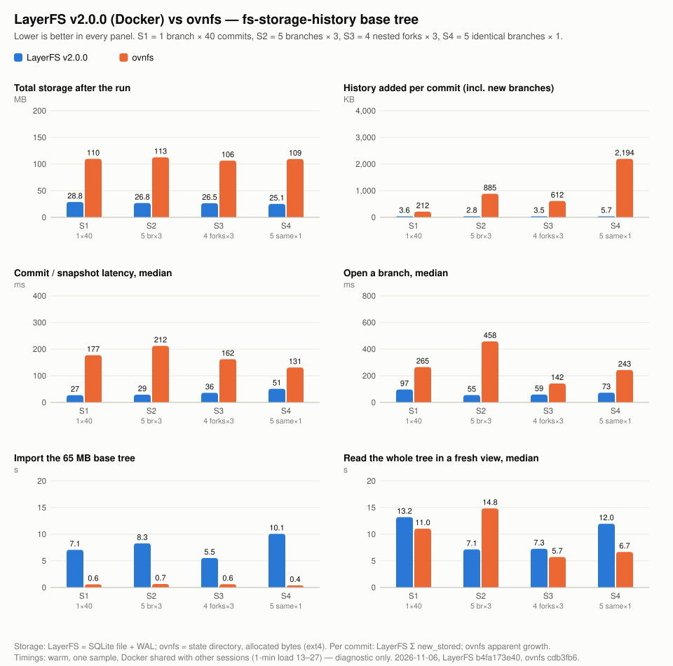
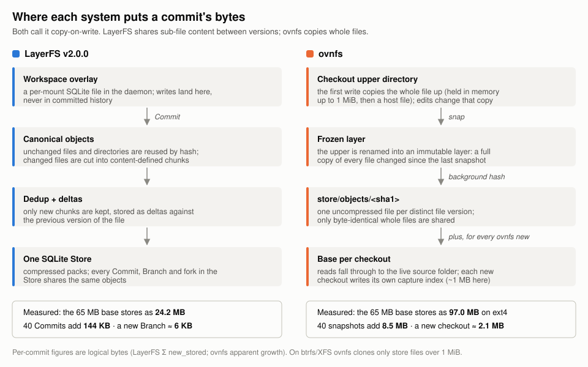

# comparision/ovnfs — LayerFS v2.0.0 vs ovnfs: storage and speed on small history shapes

> group: comparison · measures: storage, speed (diagnostic) · run 2026-11-06

> **Update 2026-11-08 (cold):** speed as the exec of each file operation plus the commit, with
> caches inside the Docker VM emptied before every commit (3 samples, 13 cases, every eviction
> verified). On multi-branch histories LayerFS `b9c4adcb` runs the file operation 1.3–1.7× faster
> and commits 1.5–2.2× faster than ovnfs; on large files 1.5–4.9× and 7.4–21× faster. ovnfs needs
> 7.6–10% more space on the histories and 3–20× more on large files, and is faster with 500 MiB of
> new data. In explicit cold read cases ovnfs reads 1.3–1.5× faster on a many-file tree and about
> 6× faster on a 500 MiB file. See [rerun-2026-11-08-cold/report.md](rerun-2026-11-08-cold/report.md).
>
> **Update 2026-11-08:** with the commit speed work merged (`layerfs_v2_0_0` @ `b9c4adcb`),
> LayerFS commits an appended 500 MiB in 1.40 s (ovnfs 1.35 s) and a brand-new
> 500 MiB file in 1.82 s (ovnfs 0.84 s), storing only the new data. Edits and cuts
> on a 500 MiB file still commit in 15–19 ms against ovnfs's 0.77–1.14 s. On S1–S4 LayerFS
> stores 8–10% fewer bytes; ovnfs imports 6–8× faster and reads 2–5× faster. See
> [rerun-2026-11-08-commit-speed/report.md](rerun-2026-11-08-commit-speed/report.md).
>
> **Update 2026-11-07 (evening):** with the exec and import speed work merged (`layerfs_v2_0_0`
> @ `c421d9db`), LayerFS imports S1–S4 2.3–2.5× faster (2.2–3.1 s; ovnfs is still 6–8× faster),
> its edit step drops 39–46 ms, and a 500 MiB file imports in 5.0 s (was 32.1 s) and commits
> about 35× faster than ovnfs, storing 3–8 KB per commit against a full copy. Cutting 500 MiB
> from a file commits in 22 ms (ovnfs 1.1 s); appending 500 MiB commits 5× slower than ovnfs
> (6.9 s vs 1.35 s) while storing half as much. Creating a new 500 MiB file commits 4.7× slower
> than ovnfs (3.9 s vs 0.84 s); removing one is cheap on both. See
> [rerun-2026-11-07-v2-speed/report.md](rerun-2026-11-07-v2-speed/report.md).
>
> **Update 2026-11-07:** rerun with ovnfs `5d54cb0` (now packs, compresses and
> delta-encodes its store) and LayerFS `layerfs_v2_0_0` @ `751b6b83`, same day and load.
> ovnfs now needs 7–10% more space than LayerFS (not 3.8–4.4×) and adds 11–35× more bytes
> per commit; ovnfs reads the full tree about 2× faster and imports about 14× faster. The
> rerun's commit timings mostly measured the `docker exec` route into ovnfs (an ovnfs commit
> takes 8–12 ms inside its container), so it doesn't show which system commits faster; the
> 11-06 commit ratios below include the same route cost (84–93 ms per call then). See
> [rerun-2026-11-07/report.md](rerun-2026-11-07/report.md). The tables below are the
> 2026-11-06 run, and the design summary below describes ovnfs before that change; see
> [rerun-2026-11-07/design.md](rerun-2026-11-07/design.md) for the current design comparison.

**LayerFS v2.0.0 (Docker machine, SQLite Store) held the same histories in 3.8–4.4× less
space than ovnfs. It added about 3.6 KB per commit against ovnfs's 212 KB to 2.2 MB per
commit, and committed 2.6–7.3× faster (median 27–51 ms vs 131–212 ms). ovnfs imported the
65 MB starting tree about 10× faster (0.4–0.7 s vs 5.5–10.1 s). Full-tree reads were slow
and noisy on both.** All 15 branch heads per arm matched the host oracle. Storage numbers
are exact bytes. Timings are warm, one sample, taken while other sessions were loading
Docker: diagnostics, not qualified performance claims.





## What was compared

| | LayerFS | ovnfs |
| --- | --- | --- |
| Version | `layerfs_v2_0_0` @ `b4fa173e401fc87af6610c151225096288e4ba57` | `stencil-hq/ovnfs` @ `cdb3fb6b880604ba1c57c28db15304f4c5525ab3` |
| Build | release CLI sha256 `69d320f8…a9348`; sealed Linux bundle, seal `a8c8daf3…2d37` (toolchain 1.85.1) | `CGO_ENABLED=0 go build`, go1.27.3, linux/arm64 ([harness/ovnfs.Dockerfile](harness/ovnfs.Dockerfile)) |
| Where it ran | public CLI on macOS → Docker machine worker + Sandbox (image `fsh-cmp-layerfs:b4fa173e`) | daemon + FUSE in one container (`fsh-cmp-ovnfs:cdb3fb6`) on the same Docker engine |
| Persistence | SQLite Store, Disposable profile; `LAYERFS_CONSTRUCTION_WORKERS=1` | state directory on an ext4 Docker volume (no reflinks) |
| Limits | worker and Sandbox without CPU/memory limits | container without limits (Docker VM: 8 CPUs, 8 GB) |

**Workload.** The [fs-storage-history](../../fs-storage-history/README.md) base tree
(DSH checkpoint 157: 9,404 files + 11 symlinks, 65,020,822 B) and its frozen edit model
`fsh-edit-model-v1`: 5 operations per commit (70% line edits, 10% new files, 5% deletes,
10% renames, 5% appends), using the suite's seeds. This is a separate small set labeled
`fsh-ovnfs-compare-v0`, not a run of `fs-storage-history-v1`.

| Case | Shape | Seeds | Commits |
| --- | --- | --- | ---: |
| S1 | 1 branch × 40 commits | `H01/p01/b01` | 40 |
| S2 | 5 branches from main × 3 commits | `H02/p01/b01…b05` | 15 |
| S3 | fork chain 4 deep × 3 commits | `H04/p01/l01…l04` | 12 |
| S4 | 5 branches from main × the same 1 commit | `H03/shared` | 5 |

**Operation mapping.** Each case has its own fresh Store (LayerFS) or container and volume
(ovnfs).

| Step | LayerFS (CLI) | ovnfs |
| --- | --- | --- |
| Import base | `project init <store>/p01 <base>` (after the floor Init and `store push … docker`) | `ovnfs new --name main --rule 'source *'` on a copy of the base inside the container |
| Open a branch | `branch fork` + `workspace mount` (one Sandbox per case) | `ovnfs new` from the folder (S3: `ovnfs fork <parent>`) |
| Edit step | `workspace exec ws "python3 model.py apply <ops>"` | `docker exec -w <checkout> … python3 model.py apply <ops>` |
| Commit | `workspace commit ws` | `ovnfs snap <checkout> --wait` |
| Verify / full read | fresh `workspace mount` + `model.py manifest` | `ovnfs new --from <snap>` + `model.py manifest` |

`ovnfs plan` classified all 9,415 paths as `source` anyway; `--rule 'source *'` only makes
that explicit, so every file is captured and versioned as in LayerFS.

## Results: storage (bytes)

Probes were taken at quiesced points. LayerFS: `store status` file + WAL, plus allocated
bytes read read-only from the worker volume. ovnfs: `du` of the state directory,
allocated (`-B1`) and apparent.

| Case | LayerFS after import | LayerFS final (file + WAL) | ovnfs after import (alloc / apparent) | ovnfs final (alloc / apparent) | ovnfs ÷ LayerFS, final |
| --- | ---: | ---: | ---: | ---: | ---: |
| S1 | 24,412,160 | 28,753,400 (24,629,248 + 4,124,152) | 98,168,832 / 69,120,491 | 109,776,896 / 77,594,720 | 3.82× |
| S2 | 24,489,984 | 26,821,936 (24,489,984 + 2,331,952) | 98,168,832 / 69,120,492 | 112,631,808 / 82,391,559 | 4.20× |
| S3 | 24,444,928 | 26,467,880 (24,444,928 + 2,022,952) | 98,168,832 / 69,120,492 | 106,479,616 / 76,469,094 | 4.02× |
| S4 | 24,432,640 | 25,104,232 (24,432,640 + 671,592) | 98,168,832 / 69,120,490 | 109,277,184 / 80,088,696 | 4.35× |

History cost (logical bytes added after import):

| Case | LayerFS Σ `new_stored` (of which metadata) | per commit | ovnfs apparent growth | per commit | ovnfs allocated growth |
| --- | ---: | ---: | ---: | ---: | ---: |
| S1 | 143,932 (103,047) | 3,598 | 8,474,229 | 211,856 | 11,608,064 |
| S2 | 42,156 (30,109) | 2,810 | 13,271,067 | 884,738 | 14,462,976 |
| S3 | 42,048 (29,504) | 3,504 | 7,348,602 | 612,384 | 8,310,784 |
| S4 | 28,397 (28,047) | 5,679 | 10,968,206 | 2,193,641 | 11,108,352 |

Where ovnfs's bytes went (allocated, final):

| Case | `store/` | `layers/` | `bases/` | `sources/` |
| --- | ---: | ---: | ---: | ---: |
| after import (all cases) | 95,281,152 | 4,096 | 1,052,672 | 1,777,664 |
| S1 | 100,503,552 | 4,206,592 | 2,101,248 | 1,777,664 |
| S2 | 97,460,224 | 1,724,416 | 6,295,552 | 1,777,664 |
| S3 | 96,940,032 | 1,347,584 | 2,101,248 | 1,777,664 |
| S4 | 95,412,224 | 434,176 | 6,295,552 | 1,777,664 |

## Results: speed (ms, warm diagnostic)

| Case | Arm | Commit median (p90) | Edit step median (p90) | Open branch, median | Import | Full read per branch |
| --- | --- | ---: | ---: | ---: | ---: | --- |
| S1 | LayerFS | **27** (38) | **93** (125) | **97** | 7,068 | 13,200 |
| S1 | ovnfs | 177 (328) | 145 (279) | 265 | **592** | 11,040 |
| S2 | LayerFS | **29** (45) | **102** (124) | **55** | 8,280 | 7,149 · 7,462 · 9,122 · 6,629 · 6,966 |
| S2 | ovnfs | 212 (364) | 183 (230) | 458 | **660** | 10,495 · 15,527 · 12,133 · 15,799 · 14,844 |
| S3 | LayerFS | **36** (41) | **117** (146) | **59** | 5,527 | 6,634 · 7,728 · 6,786 · 8,863 |
| S3 | ovnfs | 162 (208) | 134 (188) | 142 (`fork`) | **621** | 5,796 · 5,650 · 6,691 · 4,123 |
| S4 | LayerFS | **51** (78) | 142 (186) | **73** | 10,070 | 24,519 · 13,042 · 11,960 · 10,743 · 9,432 |
| S4 | ovnfs | 131 (202) | **130** (245) | 243 | **393** | 4,924 · 9,994 · 6,308 · 6,675 · 6,877 |

Control overhead (a no-op command through the same route, one call per case): LayerFS
`workspace exec ws true` 54–116 ms; ovnfs `docker exec … true` 84–93 ms. Both arms' edit
step includes it. Host 1-minute load across units: 13.3–27.3.

## Observations

- **Storage: whole files vs shared content.** ovnfs stores every changed file version
  whole and uncompressed in `store/`, and again as a full copy in that snapshot's layer.
  LayerFS stores only new chunks as deltas, compressed, in one Store. That gives about
  3.6 KB vs 212 KB per commit on one branch (S1), a 59× gap in logical bytes.
- **Branches.** In LayerFS a branch costs metadata only: S4's five identical branches with
  one commit each cost 28,397 B in all. Each `ovnfs new` writes its own base index
  (+1,048,576 B in `bases/` per checkout) and about as much again in other daemon state,
  so about 2.1 MB per new checkout. `ovnfs fork` (S3) skips the re-capture and is cheaper.
- **The starting tree.** LayerFS stores the 65.0 MB base as 24.2 MB (compressed and
  deduplicated). ovnfs's capture writes each of the 9,404 files as an object file:
  69.1 MB of content and 95.3 MB allocated on ext4, because every small file takes at
  least one 4 KiB block.
- **LayerFS's WAL.** In S2–S4 the Store's main file did not grow at all. All the growth
  was SQLite WAL, which this product keeps up to its 4 MiB limit, so it is a fixed cost.
  Σ `new_stored` is the per-commit cost.
- **Commit speed.** LayerFS commits in 27–51 ms (median). An ovnfs snapshot flushes the
  memory tier, renames the upper and hashes changed files: 131–212 ms.
- **Import speed.** ovnfs wins by about 10×, but the routes differ. LayerFS's `project init`
  read the base from the macOS host and encoded it into the Store. ovnfs captured a copy
  already inside its container, and copying it in (1.8–2.9 s with `docker cp`) is not
  counted.
- **Full-tree reads** (9,415 files through FUSE in a fresh view) took 4–25 s on both arms,
  against 0.37 s reading the same files directly from ext4 inside the ovnfs container (a
  labeled diagnostic). They varied up to 10× between identical runs under the shared
  load, so treat this column as noise.

## Design comparison (summary)

ovnfs copy-on-write is **file-level overlay CoW** (AUFS-style upper, frozen layers,
whiteouts, over a read-only bottom that is the live source folder), like overlayfs or
Docker layers. The first write copies the whole file up. A snapshot renames the upper
into a layer and hashes source files into a git-format object store: one uncompressed
file per blob, keyed by SHA-1, with no git header, compression or deltas. Block sharing
happens only where the host filesystem can clone (FICLONE on btrfs/XFS, `clonefile` on
APFS), for copy-up and for store objects over 1 MiB. On ext4 (this run) it never does.

That puts ovnfs close to the [Btrfs side of the 157-checkpoint experiment](https://github.com/Ephemeral-AI-Lab/layerfs/blob/main/docs/research/layerfs-vs-btrfs-157/REPORT.md)
for small-file histories: rewritten files stay unshared, and nothing deduplicates or
compresses within a file. For a small edit inside a large file on a btrfs or APFS host,
ovnfs's clone-based copy-up would share blocks the way btrfs does, but each snapshot still
re-reads the whole file to hash it. LayerFS deduplicates and delta-encodes inside each
Commit. ovnfs is built for disposable, git-integrated agent checkouts merged back with
`ovnfs apply`, not for long retained history.

## Limits

- One sample per case and arm, warm caches. Other sessions' containers were running on
  the same Docker engine (cross-worktree interference, declared, not controlled). No
  cold-cache claim; every timing is an INELIGIBLE diagnostic.
- The arms' control paths differ: the LayerFS CLI talks to its worker, while ovnfs is
  driven with `docker exec`. The no-op controls above size that overhead; it is not
  subtracted.
- LayerFS per-branch storage probes need a quiesced Store, so LayerFS has probes only at
  floor, import and final, plus per-commit `new_stored`. ovnfs was probed after every
  branch as well.
- ovnfs ran on ext4. On btrfs, XFS or APFS its copy-up and store files over 1 MiB would be
  clones; this tree's largest file is about 1.2 MB, so little would change.
- ovnfs's durability differs: store objects are not synced and memory-tier files are lost
  on a crash. LayerFS runs the Disposable profile (WAL, `synchronous=OFF`).
- Not covered: PostgreSQL Stores, long histories (500 commits), cross-project sharing,
  large files, and ovnfs on macOS (NFSv3).

## Superseded attempts (kept)

- `results/layerfs-S4.attempt1-home-perms`: the private `LAYERFS_HOME` was not mode 0700.
  `project init` refused (`Unauthorized`), the Store was removed, and S4 was rerun fresh.
- `results/ovnfs-S4.attempt1-diag-warmed`: after its first branch I ran diagnostic reads
  inside the container, which warmed caches for later branches. It was closed and released,
  and S4 was rerun fresh. Its one branch is the 47 s full read; the rerun's first read took
  4.9 s.

## Files

```
comparision/ovnfs/
  README.md                this report
  PROMPT.md                the prompts that produced it, plus a reproduction prompt
  figures/
    comparison.svg         six panels: storage, per-commit history, commit, branch open, import, full read
    design.svg             where each system puts a commit's bytes
  harness/
    compare.py             the driver: one unit (open | branch NAME | close) per command
    summarize.py           results/*/state.json -> results/summary.json
    make_figures.py        results/summary.json -> figures/comparison.svg
    ovnfs.Dockerfile       ovnfs build + runtime image (adds fuse3 and the suite's model.py)
  results/
    summary.json           per case/arm totals used by the tables and the chart
    <arm>-<case>/
      state.json           probes, per-step timings and new_stored, verification, load
      events.jsonl         every command: argv (first 6 items), exit, wall_ns, trimmed output
```

`compare.py` ran from a private campaign directory (`~/.cache/fsh-ovnfs-cmp`). It reads
`artifacts/layerfs`, `home/` (mode 0700), `xdg/` (with the sealed bundle), `empty/` and
`results/` next to itself, and the suite's `src/` from this repository. Its constants pin
the worker volume `lfs-0bb7b473-docker-data` and both image tags; change those for a new
campaign.

## Cleanup

All Stores were removed by the driver (`store remove`). The LayerFS Docker machine was
stopped, and its container `lfs-0bb7b473-docker` and volume `lfs-0bb7b473-docker-data`
were removed. Each ovnfs container and volume was removed by its `close` unit. Kept: the
images `fsh-cmp-layerfs:b4fa173e` and `fsh-cmp-ovnfs:cdb3fb6`, which share their base
layers with the LayerFS runtime image.
