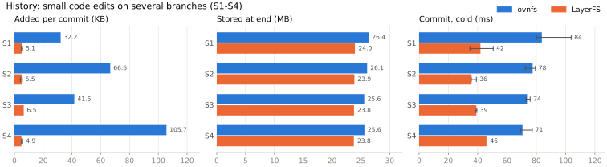
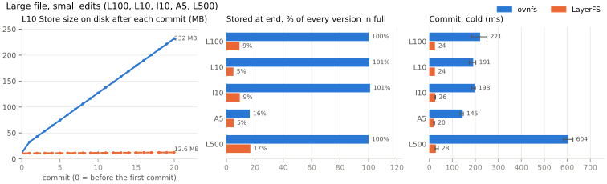
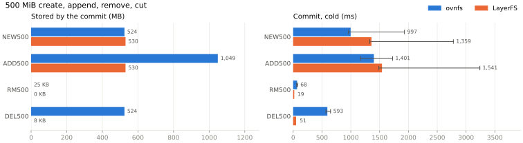

# Rerun 2026-11-08 (cold): LayerFS `b9c4adcb` vs ovnfs `5d54cb0`

**With caches inside the Docker VM emptied before every commit, LayerFS committed small edits 1.5–2.2× faster than ovnfs on multi-branch histories and 7.4–21× faster on large files. On storage, ovnfs needed 7.6–10% more space on the histories and 3–20× more on large files. ovnfs committed a brand-new or appended 500 MiB file faster (1.0 s vs 1.4 s and 1.4 s vs 1.5 s) and read data back faster in 11 of 13 cases.**

All 78 runs passed: 13 cases × 3 samples × 2 systems, and every head matched its oracle. Each of the 990 cache evictions was checked afterwards: 0 bytes of the evicted files were left in memory. Storage numbers are exact bytes; a cold timing is the median of 3 samples. Cold applies inside the Docker VM only (see [Cold method](#cold-method)).

## Configuration

| | LayerFS | ovnfs |
| --- | --- | --- |
| Version | `layerfs_v2_0_0` @ `b9c4adcb04f3445d1488698d4956f2010798a6d9`; CLI and bundle built from `bd21785a1f`, the same tree | `stencil-hq/ovnfs` @ `5d54cb0aec474c9aad90f43214ae4ba2bfab1d89` (image `fsh-cmp-ovnfs:5d54cb0`) |
| Where it ran | public CLI on macOS → Docker machine: worker container, Sandboxes as namespaces in it | daemon + FUSE in one container per case |
| Persistence | SQLite Store, Disposable, on the worker's Docker volume; `LAYERFS_CONSTRUCTION_WORKERS=1` | state directory on an ext4 Docker volume |
| Host | macOS; Docker Desktop VM (Apple Virtualization framework, 8 CPUs, 8 GiB) | same |
| Ran (+08) | 2026-11-08 02:03–02:41, both systems interleaved per case; LayerFS first in samples 1 and 3, ovnfs first in sample 2. L10 storage-growth run: 02:56 | same |
| Host 1-minute load | 7.4–16.4 | same |

The workloads match the earlier reruns: S1–S4 from the fs-storage-history edit model ([harness/compare.py](harness/compare.py)) and the `fsh-ovnfs-largefile-v0` file cases ([harness/largefile.py](harness/largefile.py)). This run adds the cold boundaries below and four small-edit cases (L100, L10, I10, A5).

## Cold method

A cold boundary comes **before every commit** and **before each final read**.

| Boundary | LayerFS | ovnfs |
| --- | --- | --- |
| Before each commit | flush the Store's files and the Sandbox's written-data files, then drop their pages from the VM's page cache | flush the whole ovnfs volume (state + source folder), then drop its pages |
| Before each final read | close the Sandbox, restart the machine (worker container and every LayerFS process), create a new Sandbox, mount, then evict as above | stop and start the ovnfs daemon, open a fresh checkout of the last snapshot, then evict as above |

- **How eviction works:** [harness/evict.py](harness/evict.py) runs in a throwaway read-only helper container on the system's own volume. For each file it calls `fsync` then `posix_fadvise(DONTNEED)`, and records resident bytes before and after with util-linux `fincore`. A boundary counts as cold only if 0 bytes remain.
- **Evidence:** every one of the 990 boundaries ended at 0 bytes, and 76.4 GB of evicted pages were dropped in total. Each sample keeps its record in `results/*/state.json`. Evictions took 0.19–3.26 s, outside every timer. The only exception is a 32 KiB `-shm` file that LayerFS keeps memory-mapped, which is reported but not counted.
- **Not controlled:**
  - *Daemon memory during commits.* Both daemons keep running between the edit and the commit, so their own in-memory caches stay warm there.
  - *Filesystem metadata caches* in the VM. Only a VM-wide drop can clear them, and that would touch other owners' containers.
  - *The macOS cache under the VM's disk image.* After eviction the VM reads at 2.9–3.1 GB/s, against 4.9 GB/s warm. That's consistent with real SSD reads, but an empty host cache can't be proved without purging the shared Mac.
  - *Program files* (python3, the system binaries) on both systems.
- **Flushing moves work out of the timer.** Because the flush happens before the timed commit, data the edit wrote no longer has to be written back during the commit. That's why ovnfs commits DEL500 and L500 faster cold than warm (0.59 s vs 1.14 s, 0.60 s vs 0.95 s).
- **Import and exec are not cold.** They're excluded from the figures and listed as warm diagnostics at the end.

## History: small code edits on several branches

S1 is 1 branch with 40 commits; S2 is 5 branches off main with 3 commits each; S3 is a chain of 4 branches with 3 commits each; S4 is 5 branches making the same edit. All start from the same 65 MB source tree.

| Case | States | Raw (MB) | Distinct files (MB) | Stored at end: ovnfs (MB) | Stored at end: LayerFS (MB) | Raw ÷ stored: ovnfs | Raw ÷ stored: LayerFS | Added per commit: ovnfs (KB) | Added per commit: LayerFS (KB) |
| --- | ---: | ---: | ---: | ---: | ---: | ---: | ---: | ---: | ---: |
| S1 | 41 | 2,665.7 | 65.6 | 26.37 | **23.97** | 101× | **111×** | 32.2 | **5.1** |
| S2 | 16 | 1,040.3 | 65.0 | 26.09 | **23.88** | 40× | **44×** | 66.6 | **5.5** |
| S3 | 13 | 845.1 | 65.0 | 25.59 | **23.81** | 33× | **35×** | 41.6 | **6.5** |
| S4 | 6 | 390.1 | 64.7 | 25.62 | **23.78** | 15× | **16×** | 105.7 | **4.9** |

| Case | Commit, cold: ovnfs (ms) | Commit, cold: LayerFS (ms) |
| --- | ---: | ---: |
| S1 | 83.8 (80.1–103.8) | **41.9** (34.7–50.6) |
| S2 | 77.5 (72.5–79.4) | **35.8** (35.6–39.1) |
| S3 | 73.7 (73.0–75.8) | **39.1** (38.4–39.4) |
| S4 | 70.6 (69.3–77.2) | **46.0** (45.9–46.3) |

- **Raw** counts every state's file bytes, including the imported base. **Distinct files** counts each distinct file content once. **Stored** is the Store size at the end: SQLite file + WAL for LayerFS, `du` of the state folder for ovnfs. "Added per commit" is (stored at end − stored after import) ÷ commits.
- **Total storage:** ovnfs ends 7.6–10.0% larger. The base tree dominates the total.
- **Per commit:** ovnfs adds 6–22× more than LayerFS. In LayerFS's own accounting, delta + zstd shrinks each commit's canonical bytes 11–28× (S1: 2,356 → 109 KB over 40 commits). About two-thirds of what remains is metadata (nearly all of it on S4), and the SQLite Store grows 1.5–2.6× beyond that.
- **Commit:** LayerFS is 1.5–2.2× faster cold. Small-history commits include each system's route (CLI to worker, or `docker exec`); in the [morning rerun](../rerun-2026-11-07/report.md), an ovnfs commit took 8–12 ms inside its container.

## Large file, small edits

| Case | File | Edit, per commit | Commits |
| --- | --- | --- | ---: |
| L100 | 100 MiB | overwrite 100 B | 10 |
| L10 | 10 MiB | overwrite 100 B | 20 |
| I10 | 10 MiB | insert 100 B (shifts the rest) | 10 |
| A5 | 5 MiB | append 16 KiB | 20 |
| L500 | 500 MiB | overwrite 100 B | 5 |

| Case | Raw (MB) | Stored at end: ovnfs (MB) | Stored at end: LayerFS (MB) | Stored ÷ raw: ovnfs | Stored ÷ raw: LayerFS | Added per commit: ovnfs | Added per commit: LayerFS |
| --- | ---: | ---: | ---: | ---: | ---: | ---: | ---: |
| L100 | 1,153.4 | 1,154.7 | **106.3** | 100% | **9%** | 104.9 MB | **5.3 KB** |
| L10 | 220.2 | 221.5 | **10.9** | 101% | **5%** | 10.5 MB | **5.5 KB** |
| I10 | 115.3 | 116.6 | **10.9** | 101% | **9%** | 10.5 MB | **5.3 KB** |
| A5 | 113.5 | 18.7 | **5.9** | 16% | **5%** | 613 KB | **18.4 KB** |
| L500 | 3,145.7 | 3,146.9 | **530.4** | 100% | **17%** | 524.3 MB | **7.4 KB** |

| Case | Commit, cold: ovnfs (ms) | Commit, cold: LayerFS (ms) |
| --- | ---: | ---: |
| L100 | 221.1 (181.9–250.9) | **24.5** (22.0–24.8) |
| L10 | 190.9 (173.2–202.3) | **24.4** (23.0–24.4) |
| I10 | 197.9 (182.9–200.2) | **25.5** (22.6–27.3) |
| A5 | 145.2 (133.8–147.9) | **19.5** (19.1–22.8) |
| L500 | 603.9 (583.9–624.7) | **28.1** (25.8–38.9) |

- **Storage:** ovnfs keeps every version of an overwritten or inserted-into file in full, about 100% of raw. LayerFS keeps 5–17%: the starting file plus a few KB per commit, almost all of it metadata (for example, 41.9 of L100's 43.4 KB). On A5, ovnfs packs the appends to 16% of raw; LayerFS stores the incompressible appended data nearly as is (delta + zstd 1.2×), ending at 5%.
- **The L10 line** is one extra run per system, measured the same way: allocated bytes of the Store's files after every commit, with the Store open. The LayerFS figure includes its write-ahead log (WAL), which is why it rises from 10.8 to 12.6 MB; after the Sandbox closes it's 10.9 MB. ovnfs rises from 11.7 to 232 MB, and is 221 MB after its daemon stops. This run was not cold; storage doesn't depend on caches.
- **Commit:** LayerFS is 7.4–21× faster cold.

## 500 MiB create, append, remove, cut

| Case | What the single commit records |
| --- | --- |
| NEW500 | a tree holding a 1 MiB file, plus a brand-new 500 MiB file |
| ADD500 | a 500 MiB file with 500 MiB appended (1000 MiB) |
| RM500 | removing an existing 500 MiB file from the tree |
| DEL500 | cutting the last 500 MiB off a 1000 MiB file |

| Case | Stored by the commit: ovnfs | Stored by the commit: LayerFS | Commit, cold: ovnfs (ms) | Commit, cold: LayerFS (ms) |
| --- | ---: | ---: | ---: | ---: |
| NEW500 | **524.3 MB** | 530.3 MB | **997** (960–1,931) | 1,359 (1,329–2,780) |
| ADD500 | 1,048.6 MB | **530.2 MB** | **1,401** (1,170–1,726) | 1,541 (1,488–3,240) |
| RM500 | 24.6 KB | **0** | 68 (60–78) | **19** (18–27) |
| DEL500 | 524.3 MB | **8.2 KB** | 593 (569–648) | **51** (50–66) |

- **New data:** ovnfs is ahead. It commits a brand-new 500 MiB file 1.4× faster and an appended 500 MiB 1.1× faster, and stores the new file 1% smaller.
- **Appending:** LayerFS stores only the new 500 MiB; ovnfs stores a new 1000 MiB copy.
- **Removing and cutting:** LayerFS commits 3.6× and 11.7× faster and stores at most a few KB.
- **Outliers:** the long LayerFS whiskers on NEW500 and ADD500 (2.8 s, 3.2 s) and ovnfs's on NEW500 (1.9 s) each come from sample 1. ovnfs's ADD500 spread is 1.2–1.7 s across all three.

## Other measurements (not in the figures)

| Group | Read, cold: ovnfs ÷ LayerFS time | Import, warm: ovnfs (ms) | Import, warm: LayerFS (ms) | Exec, warm: ovnfs (ms) | Exec, warm: LayerFS (ms) |
| --- | --- | ---: | ---: | ---: | ---: |
| History S1–S4 | ovnfs 1.26–1.77× faster | 467–680 | 2,239–3,111 | 92.7–105.6 | 56.3–82.3 |
| Large file | ovnfs 1.35–5.7× faster on 4 cases; LayerFS 1.08× faster on A5 | 98–1,124 | 128–4,326 | 95.3–217.2 | 44.5–73.7 |
| 500 MiB | ovnfs 3.8–5.2× faster on NEW500, ADD500, DEL500; LayerFS 1.04× faster on RM500 | 96–2,344 | 63–8,359 | 84.7–1,816 | 46.9–2,669 |

- **Reads:** cold reads went through a freshly restarted system on both sides. ovnfs reads faster in 11 of 13 cases.
- **Import:** a diagnostic, not cold. LayerFS sends the data from the Mac to its worker; ovnfs imports from a folder already inside its container.
- **Exec:** a diagnostic, not cold. Nothing was evicted before the edit step.

## Limits

- **Three samples per case**, on a shared host at load 7.4–16.4.
- **Cold covers the guest page cache only**, within the limits listed under [Cold method](#cold-method).
- **Stored bytes are measured differently:** LayerFS as SQLite file + WAL bytes, ovnfs as allocated bytes of its state folder. The L10 line uses allocated bytes for both.
- **The routes into each system differ:** the LayerFS CLI to its worker, and `docker exec` into ovnfs. This matters most for the small-history commits.
- **A first attempt was discarded.** A launcher bug stopped samples 2 and 3 and re-ran `close` on sample 1, which marked those records failed. None of its results are used, and its one leftover Store was removed through the CLI. One L10 storage-growth launch was discarded for the same kind of argument bug; its Workspace, Sandbox and Store were released through the CLI.

## Cleanup

Every case released its Store, Sandbox, ovnfs container and volume. After the campaign, the LayerFS machine's worker container and volume were removed, as was a stopped helper container left by the discarded attempt. Nothing owned by this run remains in Docker. The campaign home and 500 MiB base files stay in the local cache.

## Files

- [results/](results/): `<arm>-<case>.run{1,2,3}` with `state.json` (timings, storage probes, every eviction record) and `events.jsonl`; `layerfs-L10.growth` for the L10 line.
- [tables.py](tables.py) prints every number above; [charts.py](charts.py) draws the three figures.
- [harness/](harness/): the drivers with cold boundaries (`compare.py`, `lf_layerfs.py`, `lf_ovnfs.py`, `cold.py`, `evict.py`), the workload (`largefile.py`), and `run.sh` / `campaign.sh`.
